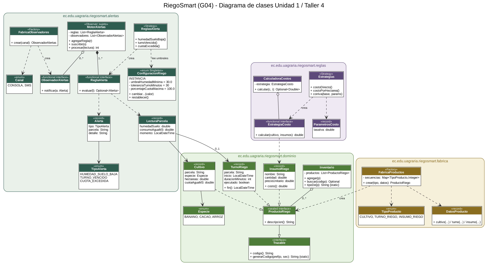

# RiegoSmart (G04) — Proyecto Integrador · Programación 3

Universidad Agraria del Ecuador · Computación en línea · 4SB · Período 2026 – 2027 CII
Docente: Ing. Hamilton Francisco Villamar Barros, MSc.

Sistema de gestión de riego para una finca del litoral ecuatoriano (banano, cacao y arroz). Este README documenta el **Taller 4: refactorización SOLID con Factory y Observer** (rama `taller04-solid-alertas`).

## Integrantes y roles del Taller 4

| Integrante | Rol en el Taller 4 |
|---|---|
| Jeremy Joshua Suarez Tomalá | Responsable de dominio y fábrica |
| Ronaldo Xavier Rivadeneira Baque | Responsable de alertas (regla HUMEDAD_SUELO_BAJA y TURNO_VENCIDO) |
| José Mauricio Tenesaca Chuni | Responsable de alertas (regla CUOTA_EXCEDIDA y observadores) |
| Lady Juliana Torres Taday | Responsable de pruebas y documentación (revisora del PR) |
| Víctor Vásquez Mejía | Responsable de pruebas y documentación (UML y README) |

## Cómo compilar y probar

Requisitos: JDK 21 y Maven.

```bash
mvn clean verify                                   # compila y ejecuta las pruebas JUnit 5
mvn -q compile exec:java -Dexec.mainClass=ec.edu.uagraria.riegosmart.DemoRiegoSmart
```

En IntelliJ IDEA: clic derecho en `DemoRiegoSmart` → *Run*, y en `src/test/java` → *Run 'All Tests'*.

## Estructura de paquetes

| Paquete | Contenido | Motivo de cambio |
|---|---|---|
| `ec.edu.uagraria.riegosmart.dominio` | `Trazable`, jerarquía sellada `ProductoRiego` (`Cultivo`, `TurnoRiego`, `InsumoRiego`), `Especie`, `Inventario` | Cambia el modelo de datos de la finca |
| `ec.edu.uagraria.riegosmart.reglas` | Estrategias de costo del Taller 3: `EstrategiaCosto`, `Estrategias`, `CalculadoraCostos`, `ParametrosCosto` | Cambia una fórmula de costo |
| `ec.edu.uagraria.riegosmart.fabrica` | `FabricaProductos`, `TipoProducto`, `DatosProducto` | Cambia la forma de crear o codificar productos |
| `ec.edu.uagraria.riegosmart.alertas` | `TipoAlerta`, `Alerta`, `LecturaParcela`, `ReglaAlerta`, `ReglasAlerta`, `ConfiguracionRiego`, `ObservadorAlertas`, `MotorAlertas`, `Canal`, `FabricaObservadores` | Cambia una regla, un umbral o un canal de aviso |

## Paso 2 — Diagnóstico del código antes de refactorizar

| Pregunta | Respuesta del grupo |
|---|---|
| ¿Qué clase tiene más de un motivo para cambiar? ¿Cuáles son? | `Estrategias` (Taller 3) mezclaba las fórmulas con los valores de referencia `VALOR_JORNAL` e `IVA`: cambiaba si cambiaba una fórmula **o** si cambiaba la tasa del IVA. `Lote` guardaba los datos del lote **y** calculaba los jornales por cultivo. `Main` creaba los objetos, calculaba e imprimía. |
| ¿Dónde se usa `new` directamente sobre los records del dominio? | En `Main` y en `CalculadoraCostosTest` (`new Lote(...)`, `new Insumo(...)`, `new Banano(...)`), repetido en cada lugar que necesitaba datos de prueba. |
| ¿Hay umbrales o tarifas escritos como números sueltos dentro de una regla? | Sí: `IVA = 0.15` y `VALOR_JORNAL = 18.50` dentro de `Estrategias`, y los jornales `18`, `25`, `20`, `12` dentro del `switch` de `Lote`. |
| ¿Hay alguna herencia que exista solo para reutilizar código? | No. Los cultivos ya eran records que implementan una interfaz sellada (relación «es un» real). Se mantuvo la composición: la calculadora **tiene** una estrategia. |

**Qué se cambió:** la tasa del IVA pasó a `ParametrosCosto`; todos los `new` sobre records del dominio se concentran en `FabricaProductos`; los umbrales de las alertas viven solo en `ConfiguracionRiego`; `Inventario` solo almacena y consulta.

## Tabla SOLID (sección 3.4 del corte)

| Principio | Dónde se nota en el proyecto |
|---|---|
| **S** — Responsabilidad única | `ReglasAlerta` decide si hay alerta, cada observador solo avisa por su canal, `MotorAlertas` solo coordina e `Inventario` solo guarda productos. |
| **O** — Abierto/Cerrado | Para agregar una alerta nueva se crea otra `ReglaAlerta` y se registra con `agregarRegla(...)`; para un canal nuevo, otro observador con `suscribir(...)`. `MotorAlertas` no se modifica. |
| **L** — Sustitución de Liskov | Toda `ReglaAlerta` devuelve `Optional<Alerta>` y nunca lanza excepciones por «no aplica»; `Cultivo`, `TurnoRiego` e `InsumoRiego` se usan donde se espera `ProductoRiego` sin sorpresas. |
| **I** — Segregación de interfaces | `ReglaAlerta`, `ObservadorAlertas` y `EstrategiaCosto` tienen un solo método cada una, por eso se implementan como lambdas o con `bitacora::add`. |
| **D** — Inversión de dependencias | `MotorAlertas` depende de las interfaces `ReglaAlerta` y `ObservadorAlertas`, no de la clase que imprime o envía el SMS; `CalculadoraCostos` depende de `EstrategiaCosto`. |

## Patrones aplicados

- **Factory:** `FabricaProductos.crear(TipoProducto, DatosProducto)` con `switch` exhaustivo sin `default`; genera el código con `Trazable.generarCodigo(...)` (CUL-0001, TUR-0001, INS-0001). `FabricaObservadores` crea los canales CONSOLA y SMS.
- **Observer:** `MotorAlertas` es el sujeto; los observadores son la consola, el SMS simulado y una bitácora en memoria (`List<Alerta>` suscrita con `bitacora::add`).
- **Strategy:** cada alerta es una `ReglaAlerta` escrita como lambda; las estrategias de costo del Taller 3 siguen en el paquete `reglas`.
- **Singleton:** `ConfiguracionRiego.INSTANCIA` (enum de una constante) guarda todos los umbrales.

## Justificación de umbrales

Todos los valores se pueden cambiar en tiempo de ejecución desde `ConfiguracionRiego` sin tocar ninguna regla.

| Alerta | Umbral por defecto | Criterio del grupo |
|---|---|---|
| `HUMEDAD_SUELO_BAJA` | humedad del suelo **< 30 %** | Valor de referencia para un suelo franco con sensor de humedad volumétrica: por debajo de ese nivel el cultivo empieza a sufrir estrés hídrico. Se deja configurable porque cambia con el tipo de suelo, el cultivo y la época (seca o lluviosa). En el umbral exacto (30 %) **no** se alerta. |
| `TURNO_VENCIDO` | **30 minutos** después del fin programado del turno | Da margen a retrasos normales de operación (encendido de bomba, cambio de válvulas) sin generar falsas alarmas; pasado ese margen el turno se considera incumplido. En el límite exacto no se alerta. |
| `CUOTA_EXCEDIDA` | consumo **> 100 %** de la cuota del cultivo | La cuota asignada (m³) es el máximo permitido para la parcela; cualquier consumo por encima se reporta. El porcentaje es configurable para avisar antes (por ejemplo, al 90 %). En la cuota exacta no se alerta. |

## Pruebas (JUnit 5)

| Clase de prueba | Qué verifica |
|---|---|
| `FabricaProductosTest` (prueba 10) | La fábrica crea los tres tipos con su código y secuencia, rechaza datos inválidos y el inventario los clasifica. |
| `MotorAlertasTest` (pruebas 11 y 12) | Disparo y caso límite exacto de las tres alertas, umbral configurable en el Singleton, turno ejecutado, motor que notifica a todos los observadores y lectura que dispara las tres alertas. |
| `CalculadoraCostosTest` | Las estrategias del Taller 3 siguen funcionando después de mover los paquetes. |

Total: 23 pruebas.

## Diagrama UML

`docs/uml-unidad1.png` (fuente editable en draw.io: `docs/uml-unidad1.drawio`). Muestra la jerarquía sellada, la fábrica y el motor de alertas con las cuatro relaciones: implementación (línea punteada con triángulo vacío), composición (rombo lleno de `MotorAlertas` a `ReglaAlerta`), agregación (rombo vacío de `MotorAlertas` a `ObservadorAlertas`, que existen fuera del motor) y dependencia (línea punteada con flecha abierta, por ejemplo de `ReglasAlerta` a `ConfiguracionRiego`).



## Uso de inteligencia artificial

Se usó un asistente de IA (Claude) como apoyo para proponer la estructura de paquetes, el código de la fábrica y del motor de alertas, las pruebas y la redacción de este README. El grupo verificó que el proyecto compila con JDK 21, que las 23 pruebas pasan y que la salida de `DemoRiegoSmart` coincide con lo esperado.

## Referencias

Bloch, J. (2018). *Effective Java* (3.ª ed.). Addison-Wesley Professional.

Horstmann, C. S. (2022). *Core Java, Volume I: Fundamentals* (12.ª ed.). Oracle Press / Pearson.

Oracle. (s. f.). *Java SE 21 documentation*. https://docs.oracle.com/en/java/javase/21/
